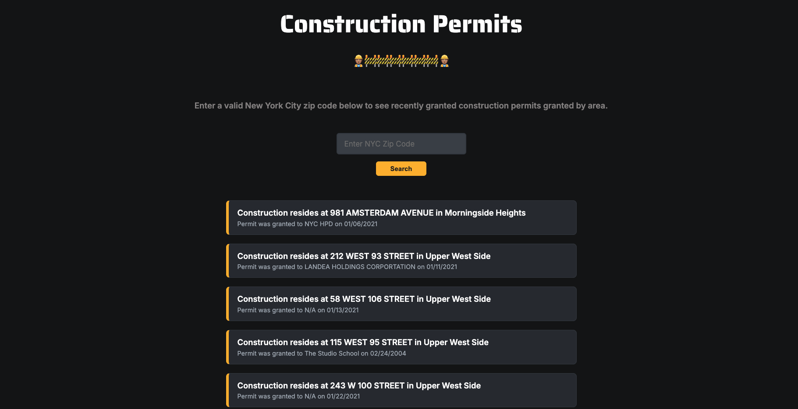

# 🚜 Construction Permits

A simple front-end app for people in the trades. Enter a New York City zip code and see recent building permits in that area: where the work is happening, who the permit was granted to, and when.

[Visit Construction Permits](https://malcolmcpu.github.io/Construction-Resources/)

## Project Preview

## Features

- Search building permits by NYC zip code
- Each result shows the address, neighborhood, permit holder, and issue date
- Results are displayed as bordered cards
- Dark charcoal and safety-yellow themed

## 🛠️Built With

- HTML5
- CSS3
- JavaScript (vanilla ES6, using `fetch`)
- [NYC Open Data](https://opendata.cityofnewyork.us/) building permits API
- [Inter](https://fonts.google.com/specimen/Inter) from Google Fonts

## How It Works

1. You enter a zip code and click **Search**.
2. `construction.js` sends a `fetch` request to the NYC Open Data permits endpoint.
3. The JSON response is filtered down to the permits whose `zip_code` matches your input.
4. For each match, the script creates a heading with the address and neighborhood and a subheading with the permit holder and date, then adds them to the page.

## Ideas for Next Steps/Stretch Goals

- Clear old results before each new search
- Show a friendly message for empty results and errors
- Format the issue date so it's easier to read
- Add search by permit type or borough

## 📚What I Learned

- Fetching JSON from a public API with `fetch` and promises
- Building page elements with `createElement` and `appendChild`
- Styling dynamically created content with CSS
